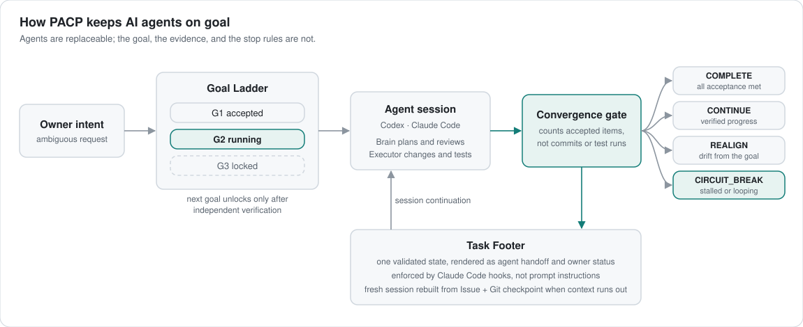

Building control planes that keep AI coding agents on goal across sessions,
engines, and machines, and using them to deliver working software in
unfamiliar domains quickly and verifiably.

<picture>
  <source media="(prefers-color-scheme: dark)" srcset="assets/pacp-control-plane-dark.svg">
  
</picture>

## Projects

| Project | What it proves | Try it |
| --- | --- | --- |
| [Canopus](https://github.com/Hsiang-Tang/canopus) | The method: frozen acceptance envelopes, convergence gates, circuit breakers, and a Claude Code Stop-hook latch that keep long-running agents on goal. Standard-library Python. | [Adopt in 15 minutes](https://github.com/Hsiang-Tang/canopus/blob/main/playbooks/adopting-canopus.md) |
| [keyflip](https://github.com/Hsiang-Tang/keyflip) | Systems work in Rust: a Zhuyin (Bopomofo) input method that tells Chinese from English by itself. Core engine, C FFI, and a macOS input-method shell, in daily use. | [Releases](https://github.com/Hsiang-Tang/keyflip/releases) |
| [network-switch-anatomy](https://github.com/Hsiang-Tang/network-switch-anatomy) | Interactive UI and networking domain knowledge: an 8-port switch drawn as a crafted machine, with a learning-bridge model, explode views, and pin-out sheets. | [Live demo](https://hsiang-tang.github.io/network-switch-anatomy/) |
| Alphalia | A shipped iOS product: a local-first investment tracker, released and iterated through App Review. | [App Store](https://apps.apple.com/tw/app/alphalia/id6804235042) |

## How I work

- Specification and acceptance criteria come first; each task is frozen
  before implementation starts.
- AI agents implement against that envelope; out-of-scope findings are
  deferred instead of growing the task.
- Every claim in a README maps to a test or a documented check, and the
  checks are run and verified locally before a change is pushed.
